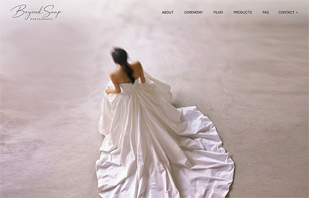
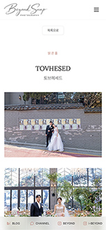
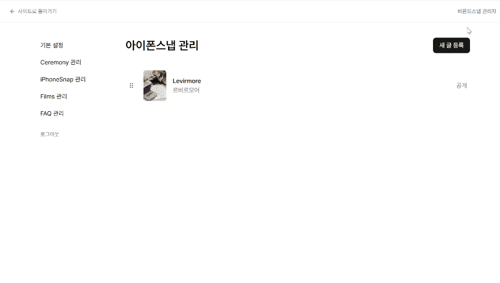

# 비욘드스냅 (Beyond Snap) 사이트 리뉴얼

**웨딩 스냅 스튜디오 [beyondsnap.co.kr](https://beyondsnap.co.kr) 공식 사이트 리뉴얼 프로젝트**<br>
**클라이언트 협의부터 개발, 배포, 작가용 관리자 화면까지 1인 진행한 외주 프로젝트**







| 항목 | 내용                                                                                |
| ---- | ----------------------------------------------------------------------------------- |
| 유형 | 외주 (웨딩 스냅 스튜디오)                                                           |
| 역할 | 기획 협의, 프론트엔드, 서버 액션/DB 설계, 배포 (1인)                                |
| 기간 | 2026.07                                                                             |
| 스택 | Next.js 16, React 19, TypeScript, Shadcn, Framer, Supabase, Cloudflare Workers / R2 |
| 링크 | https://beyondsnap.co.kr                                                            |

---

## 1. 프로젝트 배경

작가에게 사진은 곧 상품, 포트폴리오 사이트가 가장 중요한 영업 채널로 클라이언트와 협의한 요구사항은 다음과 같음

- 문의 유입 대부분이 모바일, 모바일 퍼스트 설계
- 고화질 사진 노출과 빠른 로딩 동시 만족
- 검색 유입을 위한 SEO 대응
- 클라이언트가 직접 사진, 영상, FAQ 게시물 관리
- 제한된 예산, 고정 운영비 최소화

---

## 2. 주요 기능

**사용자 사이트**

- 베뉴 유형(밝은홀, 어두운홀, 야외, 교회)별 최신 작품 숏컷
- 카테고리 필터 목록, 세로 스크롤 갤러리 상세 (필터 유지 상태로 이전/다음 이동)
- 유튜브, 비메오, 네이버TV, 카카오TV 링크 자동 embed 변환
- SNS 연결 (모바일 하단 고정 바, 데스크톱 드롭다운)

**관리자 CMS**

- 갤러리, 영상, FAQ 등록/수정/삭제, 공개 토글, 임시저장
- 다중 사진 업로드 (진행률 표시), 드래그 앤 드롭 순서 변경, 대표 썸네일 지정
- 메인 이미지, SNS 링크, 소개 문구 수정

---

## 3. 핵심 기술 의사결정

### 3-1. 브라우저에서 R2로 직접 업로드

수십 장을 한 번에 올리는 관리자 시나리오에서 서버리스 함수의 페이로드, 실행 시간 제한을 피하기 위해 presigned URL 방식 선택
파일 바이트는 서버를 거치지 않고, 서버는 URL 발급과 DB 기록만 담당

```
브라우저                          서버 액션                       R2 / Supabase
  │ 리사이즈(장변 1800px, WebP)       │                                │
  │ 크롭 썸네일(2:3, 960px) 생성      │                                │
  ├─ createUploadUrl() ───────────▶│ presigned PUT URL 발급          │
  ├─ PUT (직접 업로드) ─────────────────────────────────────────────▶ │ R2
  └─ confirmPhotoUpload() ────────▶│ gallery_photos row insert ────▶│ Supabase
```

- 동시 업로드 수를 제한하는 `runWithConcurrency`로 과부하 방지
- 썸네일 생성 실패 시에도 원본 업로드는 계속 진행하는 폴백 처리
- 업로드 중 페이지 이탈 시 `beforeunload` 경고

### 3-2. 업로드 시점의 이미지 최적화

- 장변 1800px 이하 WebP 리사이즈, 목록용 2:3 크롭 썸네일 별도 생성
- 파일명에 타임스탬프를 넣어 URL을 불변으로 만들고 `Cache-Control: immutable` 적용, 재방문 시 재요청 없음
- 업로드 시 저장한 `width/height`로 `aspect-ratio`를 미리 지정해 레이아웃 시프트(CLS) 방지
- 첫 2장만 `eager`, 나머지는 `lazy` 로딩

### 3-3. ISR과 변경 시 즉시 재검증

- 공개 페이지는 쿠키를 읽지 않는 전용 Supabase 클라이언트로 조회, ISR(`revalidate = 3600`) 대상으로 구성
- 관리자 저장 시 서버 액션에서 `revalidatePath`로 관련 페이지만 즉시 갱신
- 공개 페이지 속도와 저장 즉시 반영 동시 확보

### 3-4. 파일 저장소로 R2 선택

- 웨딩 스냅 특성상 사진 용량이 커서 Supabase 무료 플랜(1GB)으로는 부족
- R2는 이그레스 비용이 없어 사진 서빙에 유리
- DB는 Supabase(Postgres + RLS), 파일은 R2로 역할 분리

### 3-5. 서명된 쿠키 기반 관리자 인증

- 관리자가 1명뿐이라 Supabase Auth의 회원/권한 체계는 과하다고 판단
- Web Crypto(HMAC-SHA256)로 `만료시각.서명` 토큰을 만들어 `httpOnly` 쿠키에 저장
- 아이디, 비밀번호는 상수 시간 비교로 타이밍 공격 방지

### 3-6. 작가가 쓰기 쉬운 관리자 UX

- 드래그 정렬은 낙관적 업데이트 후 서버 반영, 실패 시 롤백
- 마우스, 터치, 키보드 입력 모두 지원 (dnd-kit)
- 공개 조건(제목, 사진 1장 이상)을 클라이언트와 서버에서 모두 검증, 사유를 문장으로 안내

### 3-7. SEO, 접근성, 반응형

- 페이지별 `generateMetadata`(OG 이미지 포함), `sitemap.ts`, `robots.ts` 구성, 관리자 `noindex` 처리
- 영상 상세에 `VideoObject` JSON-LD 적용
- 로딩 스켈레톤에 `role="status"`와 `sr-only` 안내, 링크에 `aria-label`, `aria-current` 지정
- 모바일 하단 고정 UI에 `safe-area-inset-bottom` 반영
- 모바일 기준 작성 후 FHD, QHD, 4K용 `3xl / 4xl / 5xl` 브레이크포인트 추가

---

## 4. 트러블슈팅

| 문제                                  | 원인                                                            | 해결                                                               |
| ------------------------------------- | --------------------------------------------------------------- | ------------------------------------------------------------------ |
| presigned 업로드 서명 불일치로 실패   | 서명에 포함되는 `Cache-Control` 값이 서버와 클라이언트에서 다름 | `lib/r2/constants.ts` 한 곳에서 값 공유                            |
| 관리자 저장 직후에도 이전 데이터 노출 | Next.js `fetch` 캐시 적용                                       | admin 클라이언트에 `cache: "no-store"` 적용, `revalidatePath` 호출 |
| 공개 페이지가 정적 생성되지 않음      | 쿠키 기반 Supabase 클라이언트가 동적 렌더링 유발                | 쿠키를 읽지 않는 `createPublicClient`로 분리                       |
| 이미지 로딩 중 레이아웃 흔들림        | 이미지 크기를 모른 채 렌더링                                    | 업로드 시 `width/height` 저장, `aspect-ratio` 선지정               |

---
